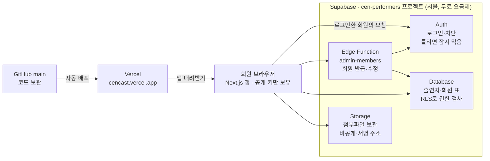

# 센 미디어 출연자 관리 PRD

Oct 30, 2026 · @홍수정

> 원본 문서: [Claude Docs의 센 미디어 출연자 관리 PRD](https://claude.ai/artifact/DZFvEqaZdyCpXjDs6SRetr) (댓글·수정은 원본에서). 이 파일은 2026-10-30에 내보낸 사본이다.

## 개요

센 미디어 제작진이 프로그램 출연자 정보를 한곳에 등록·검색·공유하는 웹 앱이며, 2026년 10월 30일부터 [cencast.vercel.app](https://cencast.vercel.app)에서 운영 중이다.

- **목적**: 출연자 정보(방송 회차, 유형, 출연료, 연락처, 서류)를 흩어진 파일 대신 한곳에 모으고, 권한이 있는 제작진만 보게 한다.
- **대상 프로그램**: 인생의 연장전, 질병의 법칙, 중독자들 등 센 미디어(CEN) 프로그램 전체
- **사용자**: 관리자가 등록번호를 발급한 센 미디어 제작진. 권한은 보기 전용 / 편집 가능 / 관리자 세 가지다.
- **현재 상태**: 운영 첫날. 회원은 관리자 CEN-0001 한 명이고 출연자 데이터는 아직 없다.
- **코드**: [GitHub redsio2/Cen-LongLife-Performers](https://github.com/redsio2/Cen-LongLife-Performers) main 브랜치 (커밋 eab7808)

## 화면과 기능

화면은 5개이고, 로그인하지 않으면 어느 화면에서도 로그인 창만 보인다.

| 화면 | 주소 | 누가 | 주요 기능 |
| --- | --- | --- | --- |
| 로그인 | 모든 화면 | 누구나 | 등록번호 + 비밀번호. 회원이 한 명도 없을 때만 ‘첫 관리자 설정’으로 CEN-0001 비밀번호를 정한다 |
| 출연자 목록 | `/` | 모든 회원 | 최신 등록순 목록, 검색·필터, 만 나이 기준일 선택, 엑셀 받기, 첨부파일 보기·골라 받기, 수정·삭제 |
| 출연자 등록 | `/new` | 편집 가능 이상 | 출연자 정보 입력, 첨부파일 올리기 |
| 회원 관리 | `/admin` | 관리자 | 등록번호 발급, 권한 변경, 비밀번호 재설정, 차단·해제 |
| 비밀번호 변경 | `/account` | 모든 회원 | 자기 비밀번호 바꾸기 (8자 이상) |

기능별 규칙:

- **검색**: 검색어는 이름·프로그램·아이템·유형·회차(예: 12회)·질병·메모·연락처를 찾는다. 연락처는 하이픈 없이 숫자만으로도 찾는다. 필터는 유형, 회차 범위, 방송일 범위, 만 나이 범위.
- **만 나이**: 생년월일로 자동 계산. 목록에서 기준일을 오늘 / 각 방송일 / 날짜 지정 중에서 고른다.
- **엑셀 받기**: 지금 보이는 목록(검색 중이면 검색 결과)을 .xlsx로 받는다. 만 나이는 화면에서 고른 기준일로 계산하고, 첫 줄은 고정된다.
- **첨부파일**: 사진·신분증·기타 서류 3가지로 분류, 파일당 최대 10MB. 사진은 크게 보기, 나머지는 새 탭으로 연다. ‘파일 받기’로 골라 받고, 여러 개면 분류별 폴더로 묶은 zip 하나가 된다.
- **수정**: 등록일은 그대로, 수정 시각을 따로 남긴다. 빼 첨부파일은 저장소에서도 지워진다.
- **삭제**: 카드 안에서 한 번 더 확인한 뒤 첨부파일까지 함께 지운다. 되돌릴 수 없다.
- **회원 발급**: 번호를 비우면 다음 빈 번호, 비밀번호를 비우면 임시 비밀번호가 만들어진다. 발급한 비밀번호는 화면에 한 번만 보인다.

## 출연자 정보 항목

필수 8개, 선택 3개에 첨부파일을 더해 등록한다. 폼에 나오는 순서대로 적었다.

| 묶음 | 항목 | 필수 | 형식·예시 |
| --- | --- | --- | --- |
| 방송 정보 | 프로그램명 | 필수 | 자유 입력, 추천: 인생의 연장전·질병의 법칙·중독자들 |
| 방송 정보 | 방송회차 | 필수 | 1 이상의 숫자 |
| 방송 정보 | 방송일 | 필수 | 날짜 |
| 방송 정보 | 아이템 | 필수 | 예: 파라다이스 그레인, 캡슐레이션 효소 |
| 출연자 정보 | 출연자 이름 | 필수 |  |
| 출연자 정보 | 출연자 유형 | 필수 | 악화사례자·성공사례자·체험단·의사·지인·기타 중 하나. 지인은 지인 메모, 기타는 유형 이름을 더 적는다 |
| 출연자 정보 | 출연료 | 필수 | 자유 입력, 예: 100만원, 지인 출연 포함 |
| 출연자 정보 | 연락처 | 선택 | 예: 010-1234-5678 |
| 출연자 정보 | 생년월일 | 필수 | 날짜, 오늘 이후 불가. 만 나이는 자동 계산 |
| 출연자 정보 | 질병 유형 | 선택 | 예: 폐암 4기 |
| 출연자 정보 | 메모 | 선택 | 예: 까다로움, 블랙리스트 |
| 첨부파일 | 사진 · 신분증 · 기타 서류 | 선택 | 여러 개 가능, 파일당 10MB 이하 |

등록일·수정일·등록한 회원은 자동으로 남는다.

## 권한과 보안

권한은 화면에서 버튼을 가리는 것과 별도로 서버(데이터베이스 RLS)에서 다시 검사하므로, 화면을 우회해도 막힌다.

| 할 수 있는 일 | 보기 전용 | 편집 가능 | 관리자 |
| --- | --- | --- | --- |
| 출연자 목록·검색·엑셀 받기 | O | O | O |
| 첨부파일 보기·받기 | O | O | O |
| 출연자 등록·수정·삭제 | X | O | O |
| 회원 번호 발급·권한 변경·비밀번호 재설정·차단 | X | X | O |
| 자기 비밀번호 변경 | O | O | O |

보안 규칙:

- **로그인**: 관리자가 발급한 등록번호(CEN-0001\~CEN-9999)와 비밀번호(8자 이상)가 둘 다 맞아야 한다. 입력은 대소문자·하이픈·띄어쓰기를 무시한다(cen 12 → CEN-0012).
- **무차별 대입 차단**: 로그인을 여러 번 틀리면 Supabase Auth가 잠시 막는다.
- **차단**: 차단된 번호는 로그인과 로그인 유지가 모두 막히고, 이미 로그인해 있어도 데이터를 못 읽는다.
- **관리자 보호**: 관리자는 자기 자신을 차단하거나 관리자 권한을 뻐 수 없다.
- **첫 관리자 설정**: 회원이 0명일 때만 열리며 2026년 10월 30일 CEN-0001 설정으로 닫혔다.
- **첨부파일**: 비공개 저장소에 두고, 회원에게만 1시간짜리 서명된 주소로 연다. 저장소의 파일 이름은 원래 이름 대신 무작위 이름이다.
- **비밀 키**: 회원 발급·수정에 필요한 secret key는 서버(Edge Function)에만 있고 브라우저에는 내려가지 않는다. 브라우저에 있는 publishable key는 공개돼도 되는 값이다.

## 기술 구성과 운영

화면은 Vercel에서, 로그인·데이터·파일은 Supabase에서 돌아가며, 브라우저는 공개돼도 되는 키만 갖는다.

브라우저의 요청은 Supabase가 회원 권한(RLS)을 확인한 뒤 처리하고, 회원 발급처럼 비밀 키가 필요한 일만 Edge Function이 대신한다.

| 항목 | 내용 |
| --- | --- |
| 화면 | Next.js 16, React 19, TypeScript, Tailwind CSS v4 |
| 배포 | Vercel. GitHub main이 바뀌면 자동 배포(약 30초) |
| 서버 | Supabase 프로젝트 cen-performers (서울, 무료 요금제) |
| 엑셀·zip | write-excel-file, fflate. 버튼을 누를 때만 불러옴 |
| 설정 코드 | 데이터베이스는 supabase/migrations, 회원 관리 함수는 supabase/functions/admin-members |

## 결정 기록

지금 구조를 정한 결정과 이유다. 최근 것부터 적었다.

| 날짜 | 결정 | 이유 |
| --- | --- | --- |
| 2026-10-30 | 배포 주소를 cencast.vercel.app으로 변경 | 짧고 기억하기 쉬운 주소 |
| 2026-10-30 | 연락처(선택) 추가, 검색 결과 엑셀 받기, 첨부파일 골라 받기 | 섭외·정산 업무에 바로 쓰기 위해 |
| 2026-10-30 | 로그인 = 발급한 등록번호 + 비밀번호 | 번호(경우의 수 9,999개)만으로는 차례로 넣어 보는 방식으로 몇 분 안에 뚫린다 |
| 2026-10-30 | 권한 3단계: 보기 전용 / 편집 가능 / 관리자 | 보기만 하는 제작진과 편집하는 제작진을 나누기 위해 |
| 2026-10-30 | Supabase 새 프로젝트(cen-performers, 서울, 무료) 사용 | 여러 사람이 같은 목록을 공유해야 한다. 일정 관리 앱 프로젝트와 회원이 섞이지 않게 분리 |
| 2026-10-30 | 미리보기 때 브라우저에 저장한 데이터는 옮기지 않음 | 실제 데이터가 없었다 |
| 2026-10-30 | 출연료·생년월일 필수, 질병 유형·메모 선택 | 정산과 만 나이 확인에 꼭 필요 |
| 2026-10-30 | 앱 이름을 ‘센 미디어 - 출연자 관리’로 변경 | 한 프로그램이 아니라 센 미디어 전체 프로그램에 쓴다 |
| 2026-10-30 | 변경은 브랜치에서 작업 후 main에 반영, main이 바뀌면 Vercel이 자동 배포 | 혼자 작업해 PR 검토는 생략 가능 |

## 앞으로 할 일과 알려진 한계

가장 먼저 할 일은 Supabase 가입 막기와 동료 등록번호 발급이다.

할 일:

- [ ] Supabase 대시보드 → Authentication → Sign In / Providers → ‘Allow new users to sign up’ 끄기
- [ ] 배포 사이트에서 CEN-0001로 로그인해 등록·엑셀·파일 받기 한 번 써 보기
- [ ] 동료에게 등록번호 발급, 보기 전용 번호로 수정·삭제 버튼이 안 보이는지 확인
- [ ] 예전 주소(cenlonglifeperformers.vercel.app)를 새 주소로 넘기는 Redirect 설정
- [ ] 정기적으로 ‘엑셀로 받기’로 전체 목록 백업
- [ ] 실제 데이터가 쌓이면 Supabase 유료 요금제(월 약 25달러, 매일 자동 백업) 검토
- [ ] 일정 관리 프로젝트(cen-yeonjangjeon-scheduler)의 RLS 꺼짐 문제 해결

알려진 한계:

- **백업 없음**: 무료 요금제는 자동 백업이 없다. 엑셀 백업에는 첨부파일이 들어가지 않는다.
- **일시 정지**: 무료 요금제는 7일 동안 사용이 없으면 일시 정지되며, 대시보드에서 다시 켜야 한다.
- **삭제 복구 불가**: 삭제한 출연자와 첨부파일은 되돌릴 수 없다. 휴지통이나 변경 이력은 없다.
- **비밀번호 분실**: 로그인용 주소로 메일을 보내지 않아 ‘비밀번호 찾기’가 없다. 관리자가 재설정해 준다. CEN-0001 비밀번호를 잊으면 Supabase 대시보드에서 되찾아야 한다.
- **로그인용 주소 꼬리표**: 등록번호는 `cen-0001@cenlonglifeperformers.vercel.app` 형태의 로그인 ID로 저장된다. 사이트 주소와 무관하며, 바꾸면 기존 계정으로 로그인할 수 없다.
